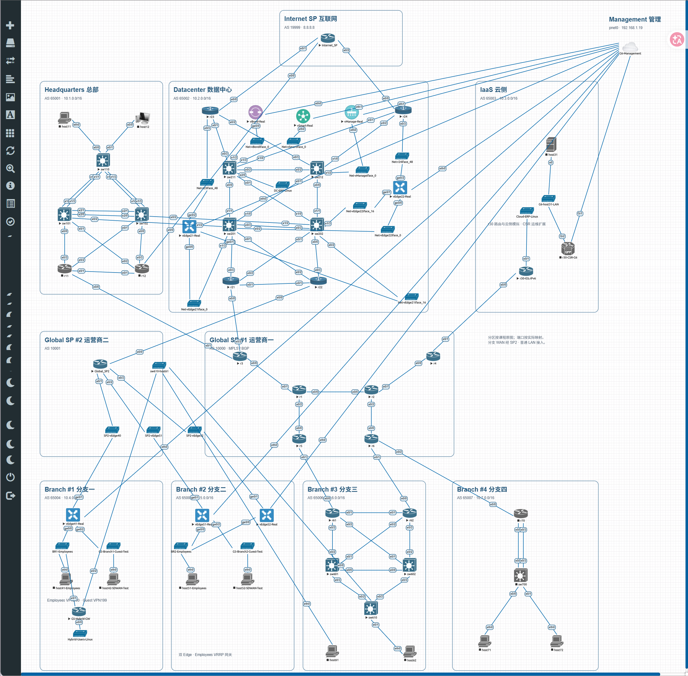

# CCIE 企业基础架构综合实验

在 EVE-NG 中部署总部、数据中心、IaaS 和四个分支，使用 OSPF/BGP、MPLS VPN、DMVPN/IPsec 与 Cisco SD-WAN 完成站点互联，并用 HTTPS/SQLite 订单服务演示双路径接管和云侧迁移。

本目录包含项目说明、拓扑、逐台设备命令、完整部署步骤、业务脚本和实际运行结果。

## 阅读入口

| 内容 | 入口 |
| --- | --- |
| 从EVE安装完成开始部署 | [完整部署执行书](docs/deployment.md) |
| 区域、设备与业务路径 | [架构与拓扑](docs/architecture.md) |
| 课程PDF、原页和实验包 | [项目材料目录](resources/README.md) |
| 镜像与资源 | [材料准备](docs/materials.md) |
| 配置文件 | [设备配置索引](configs/README.md) |
| 正常、故障、迁移结果 | [验收记录](docs/validation.md) |
| 保存与恢复 | [恢复说明](docs/recovery.md) |
| 脚本运行位置 | [工具说明](tools/README.md) |

## 项目拓扑

原图可放大查看端口，简化逻辑图见架构文档。50个EVE节点之外，ERP与客户端通过EVE主机上的4个Linux network namespace接入，不额外创建大型服务虚机。

## 已实现的内容

- HQ/DC：VLAN、EtherChannel、生成树、VRRP、OSPF认证/BFD、DHCP和IPv6。
- 运营商与云侧：BGP、MPLS VPNv4/VPNv6、VRF选择性路由交换、IaaS双栈路径、PAT与出口接管。
- 传统分支：三台DMVPN Spoke、IPsec、EIGRP、分支接入与HSRP冗余。
- SD-WAN：vManage/vBond/vSmart三类真实组件、五台真实Edge、SP2接入、模板下发、Guest VPN199、员工VPN200和Branch 2双Edge网关。
- 同一客户端按目的业务使用SD-WAN或DMVPN，单路故障后由另一条路径接管。
- 模拟ERP三条订单从DC迁移至IaaS，保留DC原URL作为HTTPS转发入口，数据摘要一致。
- RESTCONF修改与回读、Guest Shell VRF采集、规则式故障诊断、认证和请求审计。

## 实际运行结果

最终正常采样两条track均Up、两个HTTPS入口均200。分别关闭SD-WAN和DMVPN上联后，两个入口仍为200，诊断报告为DEGRADED并指出对应故障接口。DC两台Edge模板下发Success 2/2。完整结果和采样限制见验收记录。

项目采用三类单实例控制组件和普通LAN接入；ERP使用轻量HTTPS/SQLite订单服务。

## 本地使用

1. 准备材料文档列出的镜像与授权；参考环境为EVE 32GB内存、8个处理器。
2. 导入[eve目录中的空配置拓扑](eve/README.md)，按部署执行书配置设备、证书与终端。
3. Windows项目根目录执行 `python -m pip install -r requirements.txt`。
4. 配置完再按业务章节部署Linux服务、迁移和验收。故障步骤会暂停等待采样，不整段盲贴。

项目接线和部分配置参考CLC CCIE Enterprise Infrastructure Real Lab v1.0课程，并按实际镜像及项目业务扩展调整。课程PDF、原页图片和设备镜像已整理在[resources](resources/README.md)。
